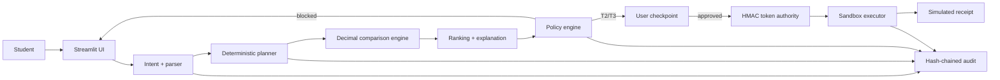

# SendSmart

> A security-first cross-border and student finance assistant for the 2026 Shenzhen International FinTechathon, Topic C.

**Status:** working prototype · **Coverage:** 50 study destinations · **Main planner:** real-data advisory · **Execution:** sandbox only

SendSmart helps an international student choose an origin and one of the 50 leading study destinations, verify a public reference exchange rate, inspect a real Wise quote preview, compare it with public World Bank corridor evidence, and understand a visible plan. A separate two-persona sandbox demonstrates deterministic approval and execution safeguards. The language model may understand and explain; it can never authorize execution.

## Data and coverage

- **Destination coverage:** the top 50 national destinations ranked by each country's latest available value for UNESCO UIS indicator `26637`, “Total inbound internationally mobile students, both sexes (number),” from the February 2026 release. Observation years differ by country.
- **Exchange rates:** live public reference rates from [Frankfurter](https://frankfurter.dev/), with a dated cached Frankfurter snapshot for offline use.
- **Provider preview:** live unauthenticated [Wise](https://docs.wise.com/guides/product/send-money/quotes) fee, conversion and ETA estimates when the requested currency pair is supported. These are not locked or executable quotes.
- **Cost benchmark:** the latest bundled quarter of [World Bank Remittance Prices Worldwide](https://datacatalog.worldbank.org/search/dataset/0037898/remittance-prices-worldwide), covering 348 observed corridors. Uncovered pairs are labelled instead of estimated.
- **Preliminary screening:** a dated [UN Security Council Consolidated List](https://main.un.org/securitycouncil/en/content/un-sc-consolidated-list) snapshot. Name matching alone is not KYC, AML clearance, or a legal decision.
- **Payments:** no real funds, account access, university verification or payment rail.

The 50-country builder supports advisory comparisons between any two countries in the catalog. Safe execution remains a deliberately narrow sandbox using the Aisha MY→UK and Carlos MX→US personas.

## Five visible capabilities

1. **Interactive corridor builder** — select origin, destination, amount interpretation, purpose, deadline, recipient name and optimisation preference.
2. **Public-rate verification** — labels every rate as live or cached and shows source and reference date.
3. **Real-data decision evidence** — shows current Wise preview options, World Bank context, preliminary UN name screening, deadline feasibility, rate/fee analysis, and a downloadable provenance report.
4. **Safe execution demo** — Decimal-only math, permission tiers, document-injection detection, signed one-time tokens, replay protection and a hash-chained audit log.
5. **Competition evidence view** — maps generated scenario, attack, intent and audit evidence to the official 40/30/30 judging criteria while keeping prototype limitations visible.

## Demo screenshots

> Add final screenshots here after recording: Chat & Plan, policy tier, Attack Lab, and Value tab.

## Architecture



The authorization boundary is deliberately narrow: only the deterministic policy engine can permit token issuance, and the sandbox rejects missing, forged, expired, replayed, or request-mismatched tokens.

## Quick start

Requirements: Python 3.11+.

```bash
python -m venv .venv
.venv\Scripts\activate
python -m pip install -e ".[ui,llm,dev]"
python -m pytest
python scenarios/run_scenarios.py
python evaluation/eval_intent.py
python -m streamlit run app.py
```

GNU Make users can run `make install`, `make test`, `make scenarios`, `make eval`, and `make run`.

No API key is required. The corridor builder attempts live Frankfurter and Wise requests; Frankfurter has a bundled public fallback, while unavailable Wise previews are labelled rather than fabricated. World Bank and UN snapshots are bundled for reproducibility. If `ANTHROPIC_API_KEY` is absent, the tested deterministic fallback remains fully usable.

For Streamlit Community Cloud, use `app.py` as the main file and follow [the deployment guide](docs/DEPLOYMENT.md). Runtime dependencies are intentionally separated from test and dataset-build dependencies.

## Permission tiers

| Tier | Condition | User action | Execution |
|---|---|---|---|
| T1 ADVISE | Compare-only | Review | Disabled |
| T2 CONFIRM | Verified beneficiary, up to USD 500 equivalent, caps pass | Click Confirm | Simulated |
| T3 APPROVE | Verified beneficiary, above USD 500 through USD 10,000 equivalent, caps pass | Exact typed phrase | Simulated |
| BLOCKED | Any hard guardrail fires | Resolve externally or re-quote | Impossible; no token issued |

Blocking controls include unverified beneficiary, changed bank fingerprint, hard limit, daily cap, fictional sanctioned destination, source-document instruction injection, stale quote, and a stricter personal limit.

## Repository map

```text
data/                 UNESCO, Frankfurter, World Bank and UN snapshots; sandbox fixtures
scripts/              reproducible World Bank and UN snapshot builders
src/sendsmart/integrations/ Wise preview and UN screening adapters
src/sendsmart/agent/  intent, parsing, planning, orchestration, explanation
src/sendsmart/core/   FX, Decimal pricing, business-day ETA, ranking
src/sendsmart/security/ policy, guardrails, injection, tokens, audit
src/sendsmart/execution/ simulated executor
src/sendsmart/control/ approvals and preference constraints
src/sendsmart/metrics/ value calculations
src/sendsmart/ui/     Streamlit demo
scenarios/            22 executable competition scenarios
evaluation/           intent benchmark runner
evidence/             generated logs, results and metrics
tests/                unit, property-style and end-to-end tests
docs/                 technical, security, value, demo and deployment material
```

## Evidence

Current generated evidence is under `evidence/`. Regenerate it with:

```bash
python scenarios/run_scenarios.py
python evaluation/eval_intent.py
```

The runners exit non-zero when a required target fails. See [Execution Evidence](docs/EXECUTION_EVIDENCE.md) and [Value Methodology](docs/VALUE_METHODOLOGY.md).

## Data disclosure

The main planner uses public UNESCO, Frankfurter, World Bank and UN data plus Wise's unauthenticated quote-preview endpoint. The Wise response is real but remains an estimate: it is not authenticated, rate-locked, funded, or executable. The separate guarded-execution demo retains fictional providers, beneficiaries, policies and receipts so its fixed competition security scenarios remain reproducible.

## Limitations

- No real payment rail, KYC, source-of-funds checks, institutional account verification, or custody.
- UN snapshot matching is preliminary only; production screening needs continuously updated sanctions/PEP/adverse-media data and human case review.
- The 50-country ranking is global inbound mobility, not a China-only outbound ranking; latest observation years vary.
- The selected country's primary currency is used; multi-currency countries and alternate tuition billing currencies are not yet modelled.
- Frankfurter rates are reference data, not guaranteed remittance quotes.
- Wise unauthenticated previews are estimates and may not represent eligibility or final availability for a specific user.
- World Bank figures are historical benchmarks and do not cover every pair among the 50 destinations.
- Real execution requires provider partnership and credentials; education-specific validation is best added through a provider such as Flywire, with regulated KYC tooling such as Sumsub.
- Regex intent and prompt-injection detection are demonstrative and bypassable.
- HMAC secret storage is environment-based and not production key management.
- Single-process, single-user demo state; no durable transaction database.
- FX timing history is illustrative, not a forecast.
- Time saved is an explicit estimate.
- The optional Anthropic adapter is a swappable boundary; the demo deliberately uses the deterministic fallback.

## Team

Team name: _add before submission_  
Members and institutions: _add before submission_

## License

MIT. Third-party notices are in [docs/THIRD_PARTY.md](docs/THIRD_PARTY.md).

