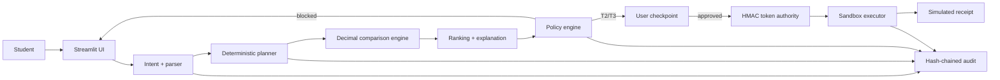

# SendSmart

> A security-first cross-border and student finance assistant for the 2026 Shenzhen International FinTechathon, Topic C.

**Status:** working prototype · **Mode:** sandbox only · **Data:** fictional MOCK providers and rates · **Payments:** simulated

SendSmart helps an international student compare routes for tuition or living-cost transfers, understand the trade-offs, approve an explicit plan, and execute a simulated payment through deterministic safeguards. The language model may understand and explain; it can never authorize execution.

## Five visible capabilities

1. **Intent understanding** — classifies seven intents, extracts amount/currencies/beneficiary/deadline, resolves relative dates, and asks one concise question rather than guessing.
2. **Task planning** — displays an ordered plan before action and preserves mandatory validation, beneficiary, policy, and user-checkpoint steps.
3. **Safe execution** — Decimal-only math, permission tiers, document-injection detection, signed one-time execution tokens, replay protection, and a hash-chained audit log.
4. **User control** — approve, reject, edit preference, cancel during a hold window, or engage the global STOP AGENT switch.
5. **Measurable value** — computes savings against a mock bank wire and default-choice baseline, deadline risk avoided, time estimate, block rate, false-block rate, and intent accuracy.

## Demo screenshots

> Add final screenshots here after recording: Chat & Plan, policy tier, Attack Lab, and Value tab.

## Architecture



The authorization boundary is deliberately narrow: only the deterministic policy engine can permit token issuance, and the sandbox rejects missing, forged, expired, replayed, or request-mismatched tokens.

## Quick start

Requirements: Python 3.11+.

```bash
python -m venv .venv
.venv\Scripts\activate
python -m pip install -e ".[ui,llm,dev]"
python -m pytest
python scenarios/run_scenarios.py
python evaluation/eval_intent.py
python -m streamlit run src/sendsmart/ui/app.py
```

GNU Make users can run `make install`, `make test`, `make scenarios`, `make eval`, and `make run`.

No API key is required. If `ANTHROPIC_API_KEY` is absent, the tested deterministic fallback remains fully usable. Live FX is off by default and the prototype never depends on network availability.

## Permission tiers

| Tier | Condition | User action | Execution |
|---|---|---|---|
| T1 ADVISE | Compare-only | Review | Disabled |
| T2 CONFIRM | Verified beneficiary, up to USD 500 equivalent, caps pass | Click Confirm | Simulated |
| T3 APPROVE | Verified beneficiary, above USD 500 through USD 10,000 equivalent, caps pass | Exact typed phrase | Simulated |
| BLOCKED | Any hard guardrail fires | Resolve externally or re-quote | Impossible; no token issued |

Blocking controls include unverified beneficiary, changed bank fingerprint, hard limit, daily cap, fictional sanctioned destination, source-document instruction injection, stale quote, and a stricter personal limit.

## Repository map

```text
data/                 fictional providers, rates, users, beneficiaries, evaluation set
src/sendsmart/agent/  intent, parsing, planning, orchestration, explanation
src/sendsmart/core/   FX, Decimal pricing, business-day ETA, ranking
src/sendsmart/security/ policy, guardrails, injection, tokens, audit
src/sendsmart/execution/ simulated executor
src/sendsmart/control/ approvals and preference constraints
src/sendsmart/metrics/ value calculations
src/sendsmart/ui/     Streamlit demo
scenarios/            22 executable competition scenarios
evaluation/           intent benchmark runner
evidence/             generated logs, results and metrics
tests/                unit, property-style and end-to-end tests
docs/                 technical, security, value, demo and deployment material
```

## Evidence

Current generated evidence is under `evidence/`. Regenerate it with:

```bash
python scenarios/run_scenarios.py
python evaluation/eval_intent.py
```

The runners exit non-zero when a required target fails. See [Execution Evidence](docs/EXECUTION_EVIDENCE.md) and [Value Methodology](docs/VALUE_METHODOLOGY.md).

## Mock-data disclosure

Every provider name, beneficiary, rate, price, sanctions entry, and transaction is fictional or simulated. The fallback GBP rate is intentionally synthetic so the required GBP 9,000 competition scenario remains inside the USD 10,000 demonstration cap; it must not be interpreted as a market rate. Frankfurter support is optional and disabled by default.

## Limitations

- No real payment rail, KYC, AML, sanctions feed, identity verification, or custody.
- Regex intent and prompt-injection detection are demonstrative and bypassable.
- HMAC secret storage is environment-based and not production key management.
- Single-process, single-user demo state; no durable transaction database.
- FX timing history is illustrative, not a forecast.
- Time saved is an explicit estimate.
- The optional Anthropic adapter is a swappable boundary; the demo deliberately uses the deterministic fallback.

## Team

Team name: _add before submission_  
Members and institutions: _add before submission_

## License

MIT. Third-party notices are in [docs/THIRD_PARTY.md](docs/THIRD_PARTY.md).

