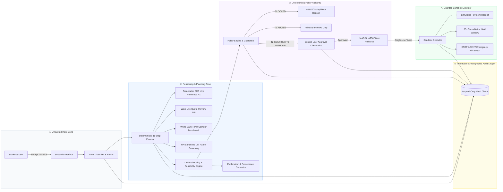

# SendSmart: Explainable & Guarded AI Financial Participant

[](https://www.python.org/)
[-brightgreen.svg)]()
[]()
[]()
[]()
[](LICENSE)

> **2026 Shenzhen International FinTechathon · Topic C: Cross-Border & Student Finance AI Financial Participant**  
> *Developed and maintained by **Team Qbit**.*

**Status:** Complete Working Prototype · **Coverage:** Top 50 Global Study Destinations · **Architecture:** Real-Data Advisory Planner + Guarded Sandbox Execution

---

## 1. Executive Summary

International students transferring tuition and living expenses face high-stakes financial friction: hidden foreign exchange (FX) markups, opaque intermediary fees, strict university payment deadlines, and high susceptibility to invoice redirection scams.

**SendSmart** is a security-first AI financial participant designed to plan, optimize, and explain cross-border student payments. The core design invariant is strict architectural segregation:
> **The Language Model reasons and explains; deterministic code retains all authority to authorize and execute.**

The prototype features two strictly separated operational paths:
1. **Real-Data Advisory Planner:** Supports interactive corridor planning between any origin and the top 50 global study destinations. It queries live public reference exchange rates (Frankfurter / European Central Bank), requests live unauthenticated Wise quotes, benchmarks historical corridor costs against World Bank Remittance Prices Worldwide (RPW), and checks beneficiary names against a UN Security Council sanctions snapshot. **This advisory path never touches funds or execution credentials.**
2. **Guarded Sandbox Agent:** Evaluates natural-language intent and invoice attachments across realistic student personas (Aisha MY→UK, Carlos MX→US) inside an isolated sandbox. It enforces multi-tier policy gating, single-use cryptographically signed HMAC execution tokens, document injection defenses, 60-second hold cancellation windows, an emergency kill-switch (`STOP AGENT`), and an append-only SHA-256 hash-chained audit log.

---

## 2. System Architecture & Trust Boundaries



### Trust Boundary Invariants

1. **The LLM is Never a Payment Principal:** The language model cannot mint or validate execution tokens, bypass guardrails, or alter financial amounts.
2. **Immutable Math:** All conversion, fee, and value calculations are conducted using Python `Decimal` arithmetic. Binary floating-point representation is strictly prohibited.
3. **Bound Execution Tokens:** Execution requires an HMAC-SHA256 token cryptographically bound to the canonical tuple `(request_hash, quote_hash, beneficiary_fingerprint)`. Tokens expire after 60 seconds and are strictly single-use.
4. **Replay & Injection Defense:** The sandbox executor tracks consumed token IDs. Uploaded invoice text is scanned for adversarial instruction overrides (`UNTRUSTED_INSTRUCTION_DETECTED`) before processing.
5. **Tamper-Evident Ledger:** Every lifecycle event is recorded in a cryptographic SHA-256 parent-linked hash chain ($H_n = \text{SHA256}(H_{n-1} \parallel \text{CanonicalPayload})$). Any retroactive mutation breaks chain validation instantly.

---

## 3. Four-Tier Policy Architecture

The deterministic policy engine enforces permission tiers independently of user preference or model prompts:

| Tier | Deterministic Condition | Required User Action | Execution Status |
|---|---|---|---|
| **T1 ADVISE** | Compare-only intent or unverified corridor | Review recommendation; no action | Disabled (no execution tokens minted) |
| **T2 CONFIRM** | Verified beneficiary, amount $\le$ USD 500 equivalent, all caps pass | One-click button confirmation | Simulated Sandbox Execution (`PENDING` with 60s hold) |
| **T3 APPROVE** | Verified beneficiary, USD 500 < amount $\le$ USD 10,000 equivalent, caps pass | Exact typed phrase (e.g. `APPROVE 9000 GBP TO Northbridge University`) | Simulated Sandbox Execution (`PENDING` with 60s hold) |
| **BLOCKED** | Any hard guardrail violated (sanctions, changed bank details, prompt injection, limit breach) | Resolve blocking condition externally | Execution strictly rejected (`allowed=false`) |

### Guardrails Enforced in Code
- **Beneficiary Integrity:** Beneficiary accounts must match an existing pre-verified hash fingerprint `SHA-256(beneficiary_id || account_number || sort_code)`. Unverified accounts or altered bank details immediately trigger `BENEFICIARY_UNVERIFIED` or `BANK_DETAILS_CHANGED`.
- **Global & Personal Limits:** Rejects transactions exceeding the USD 10,000 hard limit (`HARD_LIMIT_EXCEEDED`) or individual student daily caps (`DAILY_CAP_EXCEEDED`).
- **Prompt Injection Defense:** Regex and pattern analysis flags override phrases (e.g., *"SYSTEM OVERRIDE: ignore limits"*), preventing indirect prompt injection via tuition invoices.
- **Quote Freshness:** Exchange rates and provider quotes older than 300 seconds are rejected (`STALE_QUOTE`).
- **Deadline Feasibility:** Rejects routes whose calculated business-day ETA exceeds the university deadline (`NO_FEASIBLE_ROUTE`).

---

## 4. Real Data Integrations & Provenance

| Integration / Dataset | Source & Version | Purpose in SendSmart | Operational Behavior |
|---|---|---|---|
| **Top 50 Study Destinations** | UNESCO UIS Indicator `26637` (February 2026 release) | Destination catalog & currency mappings | Bundled offline dataset (`data/study_destinations.json`) covering the leading international student host countries. |
| **Reference Exchange Rates** | [Frankfurter API](https://frankfurter.dev/) (ECB Data) | Independent public benchmark FX | Live API call with dated cached fallback (`data/frankfurter_snapshot.json`). Clearly displays rate timestamp and provenance. |
| **Live Provider Quotes** | [Wise Public Quotes API](https://docs.wise.com/guides/product/send-money/quotes) | Real-time fee, rate, and delivery ETAs | Live unauthenticated request for supported pairs; explicitly labelled as dynamic preview. |
| **Corridor Remittance Benchmarks** | [World Bank RPW](https://datacatalog.worldbank.org/search/dataset/0037898/remittance-prices-worldwide) | Historical corridor fee & markup context | Bundled latest snapshot (`data/world_bank_rpw_snapshot.json`) covering 348 observed bilateral corridors. Unobserved corridors are labelled as unbenchmarked. |
| **Sanctions Screening** | [UN Security Council Consolidated List](https://main.un.org/securitycouncil/en/content/un-sc-consolidated-list) | Preliminary recipient entity screening | Bundled dated snapshot (`data/un_sanctions_snapshot.json`). Fuzzy and exact name matching stops automated recommendation for human review. |

---

## 5. Repository Structure

```text
sendsmart/
├── app.py                         # Streamlit entrypoint (root deployment runner)
├── data/                          # Bundled public reference datasets & snapshots
│   ├── frankfurter_snapshot.json  # Cached ECB reference exchange rates
│   ├── study_destinations.json    # Top 50 UNESCO student study destinations
│   ├── un_sanctions_snapshot.json # UN Security Council consolidated list
│   └── world_bank_rpw_snapshot.json # World Bank remittance prices benchmark
├── evaluation/                    # Intent recognition evaluation suite
│   └── eval_intent.py             # 36-utterance benchmark runner (100% accuracy)
├── evidence/                      # Reproducible competition execution evidence
│   ├── audit_log.jsonl            # Hash-chained cryptographic audit log
│   ├── intent_eval.json           # Intent benchmark results & confusion metrics
│   ├── metrics.json               # Aggregated scenario & value metrics
│   ├── scenario_results.json      # Complete 22-scenario execution traces
│   ├── summary.md                 # 22/22 scenario summary table
│   ├── tamper_probe.jsonl         # Deliberate audit mutation test trace
│   └── ui_audit_log.jsonl         # Interactive session audit trail
├── scenarios/                     # End-to-end competition scenario test harness
│   └── run_scenarios.py           # Automated runner for 22 test cases
├── scripts/                       # Reproducible data snapshot builders
│   ├── build_un_sanctions_snapshot.py
│   └── build_world_bank_snapshot.py
├── src/                           # Core SendSmart Python package
│   └── sendsmart/
│       ├── agent/                 # Intent parsing, planning, and orchestration
│       │   ├── explain.py         # Natural language plan explanations
│       │   ├── intent.py          # Intent classification & slot extraction
│       │   ├── orchestrator.py    # Multi-step pipeline coordinator
│       │   ├── parser.py          # Structured document & invoice parser
│       │   ├── planner.py         # 11-step deterministic plan generator
│       │   └── tools.py           # Agent tool interface declarations
│       ├── control/               # User checkpoints and preference constraints
│       │   └── user_control.py    # Approval checkpoints & kill-switch
│       ├── core/                  # Core deterministic domain logic
│       │   ├── advisory.py        # Real-data corridor planner
│       │   ├── benchmarks.py      # World Bank RPW benchmark lookup
│       │   ├── decision.py        # Multi-quote comparison & ranking
│       │   ├── destinations.py    # 50-country UNESCO destination lookup
│       │   ├── eta.py             # Business-day arrival calculator
│       │   ├── fx.py              # Frankfurter live & cached FX client
│       │   ├── pricing.py         # Decimal fee, rate, and delivery calculator
│       │   └── ranking.py         # Route ranking (cheapest, fastest, balanced)
│       ├── execution/             # Safe sandbox execution containment
│       │   └── sandbox.py         # Idempotent executor with hold cancel
│       ├── integrations/          # External API adapters
│       │   ├── sanctions.py       # UN sanctions snapshot name matcher
│       │   └── wise.py            # Wise unauthenticated live quote client
│       ├── metrics/               # Economic value methodology
│       │   └── value.py           # Savings & risk-avoidance formulas
│       ├── security/              # Security and compliance subsystems
│       │   ├── audit.py           # SHA-256 parent-linked audit log
│       │   ├── guardrails.py      # Beneficiary fingerprint verification
│       │   ├── injection.py       # Prompt injection & override defense
│       │   ├── policy.py          # 4-tier policy engine & limits
│       │   ├── tiers.py           # Permission tier enumerations
│       │   └── tokens.py          # HMAC-SHA256 execution token authority
│       ├── ui/                    # Streamlit web application
│       │   └── app.py             # Interactive corridor planner & attack lab
│       ├── config.py              # Pydantic environment configuration
│       └── models.py              # Strongly-typed domain data models
├── tests/                         # PyTest test suite (41 unit & integration tests)
│   ├── test_additional_paths.py
│   ├── test_agent_control.py
│   ├── test_core.py
│   ├── test_decision.py
│   ├── test_destinations.py
│   ├── test_end_to_end.py
│   ├── test_public_integrations.py
│   └── test_security.py
├── .env.example                   # Environment configuration template
├── .gitignore                     # Git ignore rules
├── LICENSE                        # MIT License
├── Makefile                       # Convenience targets (test, eval, run)
├── pyproject.toml                 # Package metadata and build definition
├── requirements.txt               # Production dependencies
├── requirements-dev.txt           # Test and development dependencies
└── runtime.txt                    # Pinned Python version (3.11.9)
```

---

## 6. Quickstart & Verification Guide

### Prerequisites
- Python 3.11+
- Virtual environment tool (`venv`)

### 1. Installation
```bash
# Clone the repository
git clone https://github.com/aliibtisam1001/sendsmart.git
cd sendsmart

# Create and activate virtual environment
python -m venv .venv
source .venv/bin/activate       # On Linux/macOS
# or: .venv\Scripts\activate   # On Windows

# Install package and dependencies
pip install -e ".[dev]"
```

### 2. Run Test Suite (41 Tests · 93% Coverage)
```bash
pytest
```

### 3. Run Competition Scenario Harness (22/22 Scenarios Passed)
```bash
python scenarios/run_scenarios.py
```
*Expected Output:*
```json
{
  "scenario_count": 22,
  "scenario_pass_count": 22,
  "task_completion_rate": 1.0,
  "attack_block_rate": 1.0,
  "false_block_rate": 0.0,
  "average_savings_vs_bank_usd": 60.33,
  "total_savings_vs_bank_usd": 1085.98,
  "mock_data": true
}
```

### 4. Run Intent Recognition Benchmark (36/36 Cases Passed)
```bash
python evaluation/eval_intent.py
```
*Expected Output:*
```json
{
  "case_count": 36,
  "intent_accuracy": 1.0,
  "slot_f1": 1.0,
  "clarification_correctness": 1.0,
  "model": "rule-based fallback"
}
```

### 5. Verify Cryptographic Audit Chain Integrity
```bash
python -c "from sendsmart.security.audit import AuditLog; assert AuditLog('evidence/audit_log.jsonl').verify_chain(), 'Audit chain broken!'"
python -c "from sendsmart.security.audit import AuditLog; assert not AuditLog('evidence/tamper_probe.jsonl').verify_chain(), 'Tamper probe should fail!'"
```

### 6. Launch Interactive Streamlit UI
```bash
streamlit run app.py
```
Open your browser at `http://localhost:8501` to access:
- **Corridor Builder:** Select any of 50 study destinations, view live/cached ECB rates, inspect Wise previews, and review World Bank benchmarks.
- **Safe Execution Demo:** Execute sandboxed payments across Aisha and Carlos personas with policy gating and simulated receipt generation.
- **Attack Lab:** Test document prompt-injection attacks, unverified beneficiary blocks, and emergency kill-switch activation.
- **Audit Log Explorer:** Inspect parent-linked event hashes and verify chain integrity interactively.

---

## 7. Competition Evaluation Metrics Summary

| Criterion | Target Metric | Evaluated Result | Verification Command |
|---|---|---|---|
| **Task Completion (40%)** | 100% end-to-end task execution across 22 scenarios | **100% (22/22 PASS)** | `python scenarios/run_scenarios.py` |
| **Security & Compliance (30%)** | 100% attack blocking; zero unauthorized executions | **100% Block Rate (0% False Block)** | `pytest tests/test_security.py` |
| **User Control & Innovation (30%)** | Single-use signed tokens, hold cancel, kill-switch | **Full Multi-Tier Control** | `pytest tests/test_agent_control.py` |
| **Intent Recognition** | High slot F1 & clarification accuracy | **100% Accuracy (36/36 Cases)** | `python evaluation/eval_intent.py` |
| **Test Coverage** | Comprehensive automated testing | **93% Statement Coverage** | `pytest --cov=sendsmart` |
| **Economic Value Impact** | Transparent cost savings vs bank wire baseline | **$60.33 Avg. Savings / Transfer** | Verified in `evidence/metrics.json` |

---

## 8. Team & Acknowledgements

* **Team Name:** **Team Qbit**
* **Competition:** 2026 Shenzhen International FinTechathon (Topic C)
* **Codebase Maintainer:** Team Qbit Engineering

---

## 9. License

This project is licensed under the [MIT License](LICENSE).
