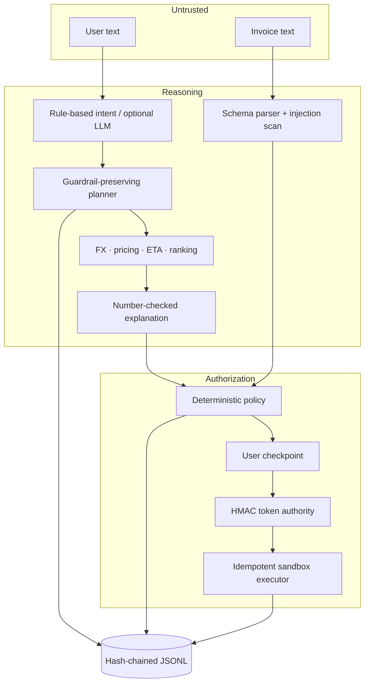

# Architecture

## Trust boundaries

SendSmart has three distinct zones. The untrusted-input zone contains chat and invoice text. The reasoning zone classifies, extracts, plans, ranks, and explains but has no execution authority. The authorization zone consists only of deterministic policy code, the token authority, and sandbox executor.

## Invariants

1. The LLM cannot mint or validate an execution token.
2. A token binds the canonical request, selected quote, amount, and verified beneficiary fingerprint.
3. Policy and user approval must precede minting.
4. Tokens expire after five minutes and are single use.
5. Executor idempotency returns the same receipt for a repeated idempotency key.
6. STOP AGENT is checked before token handling and therefore always wins.
7. A success claim requires a sandbox receipt.

## Failure recovery

Stale quote produces a re-quote plan. Failed beneficiary verification pauses for external verification. No feasible deadline produces alternatives rather than auto-execution. Any other unsafe failure returns to a user checkpoint.

