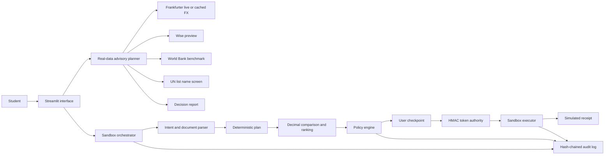

# SendSmart Technical Documentation

**Prepared by Team Qbit**

## Purpose and system boundary

SendSmart is a Python 3.11 and Streamlit prototype for planning cross-border student payments. It demonstrates how an AI-assisted financial participant can collect payment intent, compare routes, explain evidence, and preserve user control without giving a language model authority to move money.

The product contains two deliberately separate paths:

1. **Real-data advisory planner.** Users can select any origin and destination from the bundled top-50 study destination catalog. The planner uses live or cached Frankfurter reference rates, optionally requests an unauthenticated Wise preview, attaches World Bank historical corridor evidence when available, and performs preliminary name matching against a dated UN Security Council list snapshot. This path never executes a payment.
2. **Guarded sandbox agent.** Two fictional personas exercise deterministic intent parsing, mock provider comparison, policy tiers, user approval, signed one-time execution tokens, a simulated executor, cancellation, a kill switch, and a tamper-evident audit trail. This path moves no real funds.

The main architectural conclusion is that reasoning and authorization are separated. Natural-language interpretation and recommendation can propose a plan, but only deterministic policy code and an explicit user checkpoint can authorize a short-lived token, and only the sandbox accepts that token.

## System architecture

### Logical architecture

### Architectural layers

| Layer | Main responsibility | Important modules |
|---|---|---|
| Presentation | Collect inputs, show evidence, expose simulation controls, export a decision report | `ui/app.py`, root `app.py` |
| Advisory domain | Validate corridors, calculate reference conversions, assess provider previews, decide advisory status | `core/advisory.py`, `core/decision.py` |
| Public-data adapters | Retrieve or load FX, provider preview, remittance benchmark, destination and sanctions data | `core/fx.py`, `integrations/wise.py`, `integrations/sanctions.py`, `core/benchmarks.py` |
| Agent reasoning | Classify intent, extract slots, parse documents, generate an ordered plan, explain results | `agent/intent.py`, `agent/parser.py`, `agent/planner.py`, `agent/orchestrator.py` |
| Deterministic comparison | Use Decimal arithmetic for route pricing, ETA feasibility, ranking, and value metrics | `core/pricing.py`, `core/eta.py`, `core/ranking.py`, `metrics/value.py` |
| Authorization | Apply blocking rules and permission tiers independently of the language model | `security/guardrails.py`, `security/policy.py`, `control/user_control.py` |
| Execution containment | Validate bound tokens, prevent replay, enforce idempotency, create simulated receipts | `security/tokens.py`, `execution/sandbox.py` |
| Evidence | Append and verify hash-linked JSONL events and reproducible scenario results | `security/audit.py`, `evidence/`, `scenarios/`, `evaluation/` |

### Trust boundaries

**Untrusted input zone.** User text and uploaded invoice text are treated as data. Uploaded text can populate only a fixed schema and is scanned for instruction-like content.

**Reasoning zone.** Intent classification, planning, quote comparison, ranking, and explanation operate here. These functions may recommend an action but cannot mint an execution token or call a payment rail.

**Authorization zone.** Deterministic policy code, the user checkpoint, the HMAC token authority, and the sandbox executor form the narrow authorization boundary. The language model is not part of this boundary.

**External data zone.** Frankfurter and Wise are network dependencies. World Bank, UNESCO-derived destination data, and the UN list are bundled dated snapshots. Provider or data-source failure must reduce functionality rather than fabricate a result.

## End-to-end processing

### Real-data advisory flow

1. The user selects origin, destination, amount interpretation, amount, purpose, priority, deadline, and an optional recipient name.
2. `build_corridor_plan` rejects identical countries, non-positive amounts, and unknown priority values, then creates a strict `PaymentRequest`.
3. `get_public_snapshot` requests Frankfurter data. If the request fails, it loads a dated Frankfurter public-data cache. The UI labels the result as live or cached.
4. The planner calculates an independent cross-rate and before-fee conversion.
5. `fetch_wise_quotes` requests unauthenticated provider previews. Disabled payment options are discarded. Failure is displayed as unavailable; no provider price, fee, or ETA is invented.
6. A provider option is selected according to the chosen priority and compared with the independent reference rate.
7. A matching World Bank corridor benchmark is attached when available. An uncovered corridor remains explicitly uncovered.
8. If a recipient name is supplied, normalized fuzzy matching checks the bundled UN list snapshot. A possible match produces a stop-and-human-review status.
9. The interface shows the result and can export a JSON decision report containing inputs, source dates, calculations, status, and restrictions. `execution_enabled` is always false.

### Guarded sandbox flow

1. Ordered regular-expression rules classify the request into tuition, living costs, comparison, status, cancellation, preference change, or out-of-scope intent.
2. Currency, amount, beneficiary, deadline, amount mode, purpose, and priority slots are extracted. Missing or ambiguous fields produce one clarification question.
3. Optional invoice text is parsed into a fixed field set and independently scanned for prompt-injection patterns.
4. A typed plan is created. Mandatory validation, beneficiary verification, policy, and user-checkpoint steps cannot be deleted or reordered before token issuance.
5. Mock routes are priced with Decimal arithmetic, checked against the requested deadline, and ranked.
6. The policy engine evaluates all hard controls and returns T1, T2, T3, or BLOCKED.
7. T2 requires a confirmation action. T3 requires an exact phrase containing amount, currency, and beneficiary. Rejection skips all execution steps.
8. After approval, the token authority binds the exact request, selected quote, and beneficiary fingerprint into a signed token.
9. The executor checks the kill switch, idempotency key, token presence, replay status, binding, signature, and expiry before producing a simulated receipt.
10. Plan, policy, approval, execution, cancellation, and kill-switch events are appended to the hash-chained audit log.

## Core algorithms

### Cross-rate calculation

Frankfurter rates are stored relative to one base currency. For source currency `S` and target currency `T`, the reference cross-rate is:

`R(S to T) = rate[T] / rate[S]`

If the user specifies a source amount `A_s`, the before-fee target estimate is `A_t = A_s * R(S to T)`. If the user specifies the amount the recipient must receive, the required before-fee source amount is `A_s = A_t / R(S to T)`.

Money values are rounded with `ROUND_HALF_UP` to two decimal places. Currency calculations use `Decimal`, not binary floating-point arithmetic.

### Provider preview selection

The advisory planner does not claim that a provider option is globally optimal. It selects among returned Wise preview options with deterministic rules:

- **Cheapest:** minimum disclosed fee, then higher recipient amount.
- **Fastest:** earliest available delivery timestamp, then lower fee.
- **Balanced:** prefer bank-transfer pay-in options when available, then lower fee and higher recipient amount.

The result remains an unauthenticated estimate. It is neither funded nor rate-locked.

### Quote assessment

For provider source amount `A_s`, provider target amount `A_p`, provider rate `R_p`, provider fee `F`, and independent reference rate `R_r`:

- `ideal_target = A_s * R_r`
- `fee_percent = F / A_s * 100`
- `rate_difference_percent = (R_p / R_r - 1) * 100`
- `effective_cost_percent = (1 - A_p / ideal_target) * 100`

The effective-cost percentage is an explanation metric, not a provider accounting figure. Deadline feasibility is true when the provider delivery date is on or before the user's requested date.

### Simulated route pricing

For the sandbox, mock provider data supplies fixed fee, percentage fee, FX markup, business-day ETA, and reliability. With mid-rate `R_m` and markup fraction `m`, `effective_rate = R_m * (1 - m)`.

For recipient-target mode, `send_amount = target_amount / effective_rate`. For source-send mode, `recipient_amount = send_amount * effective_rate`.

The remaining values are `fee = fixed_fee + send_amount * fee_percent`, `markup_cost = send_amount * m`, and `total_cost = fee + markup_cost`.

### Deadline calculation

The ETA algorithm starts in the `Asia/Singapore` time zone. Requests made after 15:00 or during a weekend start on the next business day. It then adds provider business days while skipping Saturday and Sunday. Public holidays and provider-specific calendars are outside the current prototype.

### Route ranking

Routes meeting the deadline form the preferred candidate set. If none meet it, all routes remain visible and are labelled as deadline failures.

For each candidate, `cost_score = 1 - total_cost / maximum_candidate_cost` and `speed_score = 1 - eta_days / (maximum_candidate_days + 1)`.

The total is `score = w_cost * cost_score + w_speed * speed_score + w_reliability * reliability`.

The cheapest preset uses weights `0.75, 0.15, 0.10`; the fastest preset uses `0.20, 0.65, 0.15`; balanced uses the user's configured weights and normalizes them to sum to one. Ties are resolved by lower total cost and then provider name.

### Name screening

Recipient and list names are Unicode-normalized, converted to ASCII, uppercased, stripped to letters and digits, and whitespace-normalized. Exact normalized matches score `1.0`; other candidates use `SequenceMatcher`. Scores at or above `0.92` are returned for human review. This is a preliminary name comparison, not KYC, AML clearance, identity verification, or a legal decision.

### Intent and clarification

The fallback intent classifier uses ordered deterministic rules. Amount extraction supports ISO currency codes, common English currency names, pound signs, and dollar signs. Deadlines support ISO dates, relative day counts, weekdays, and named calendar dates. Tuition defaults to recipient-target mode unless the user explicitly describes a source send amount. Required missing slots produce one focused clarification question. An optional language-model adapter exists, but any failure returns to the deterministic classifier and the current prototype does not use model output for authorization.

## Security design

### Security objectives

The design protects amount correctness, beneficiary integrity, authorization integrity, user control, and audit evidence. Relevant adversaries include malicious document content, a compromised language model, limit evasion, stale prices, changed beneficiary details, token forgery or replay, and local audit modification.

### Permission tiers

| Tier | Deterministic condition | User action | Execution effect |
|---|---|---|---|
| T1 ADVISE | Comparison-only request | Review only | Token path is omitted |
| T2 CONFIRM | Verified beneficiary, USD equivalent at or below 500, all hard rules pass | Click or type confirm | Simulated token path enabled |
| T3 APPROVE | Verified beneficiary, above USD 500 and at or below USD 10,000, all hard rules pass | Exact amount-currency-beneficiary phrase | Simulated token path enabled |
| BLOCKED | One or more hard rules fail | Resolve externally or re-quote | No token can be issued |

### Blocking controls

The policy engine fails closed when it detects an unverified beneficiary, changed bank fingerprint, hard-limit breach, daily-cap breach, sandbox-sanctioned destination, source-document injection flag, stale quote, infeasible deadline, stricter personal-limit breach, or invalid amount. User preferences may tighten a personal limit but cannot raise it above the current limit or the USD 10,000 hard cap.

### Prompt-injection containment

Uploaded documents are non-authoritative data. The parser extracts only amount, target currency, deadline, beneficiary ID, and bank fingerprint. A separate scanner identifies previous-instruction overrides, policy bypass language, account redirection, concealment requests, system-message mimicry, hidden-text markers, and urgency combined with bypass language. Any flag blocks sandbox execution. This regex scanner is a demonstrative layer and must not be described as comprehensive protection.

### Token authorization

The token authority canonicalizes the complete request, selected quote, and verified beneficiary fingerprint as sorted compact JSON and computes a SHA-256 request binding. A token contains a random UUID, binding, issue time, expiry time, and an HMAC-SHA256 signature over those fields. The default lifetime is five minutes.

The executor independently recalculates the binding, recomputes the signature using constant-time comparison, verifies expiry, and rejects reused token IDs. A token therefore cannot authorize a different amount, quote, recipient fingerprint, or request without invalidating its signature or binding.

### Execution containment and user control

The sandbox checks the global kill switch before token processing, so STOP AGENT always wins. Idempotency keys return the same receipt instead of creating a duplicate. Accepted receipts remain pending during a configurable 60-second cancellation window. Rejection or invalid approval causes no token to be minted and marks downstream plan steps as skipped. A success claim requires an actual sandbox receipt.

### Audit integrity

Each JSONL audit event records timestamp, event type, actor, request ID, summary, decision data, previous hash, and event hash. The first event points to a 64-zero genesis hash. Each new SHA-256 digest covers the complete canonical event including the previous hash. Editing, deleting, inserting, or reordering lines breaks chain verification.

The audit is tamper-evident rather than tamper-proof. A production system should use append-only remote storage, signed checkpoints, retention policy, access control, and external hash anchoring.

## Data sources and provenance

| Source | Use | Runtime behavior | Restriction |
|---|---|---|---|
| UNESCO UIS-derived top-50 destination snapshot | Supported country catalog and primary currencies | Bundled JSON | Country observation years vary; it is global inbound mobility, not China-only outbound demand |
| Frankfurter public API | Independent reference FX | Live request with dated public-data cache fallback | Reference rate, not a guaranteed remittance quote |
| Wise unauthenticated quote endpoint | Fee, conversion, payment-option and ETA preview | Requested at plan time; unavailable responses are labelled | Not logged in, funded, eligible, rate-locked, or executable |
| World Bank Remittance Prices Worldwide | Historical corridor-cost benchmark | Bundled latest-quarter snapshot | Historical and not available for every pair |
| UN Security Council Consolidated List | Preliminary recipient-name comparison | Bundled dated snapshot | Name-only screening is not compliance clearance |
| Fictional provider and user fixtures | Reproducible security scenarios | Bundled sandbox data | Must never be represented as market pricing or real payment execution |

## Data contracts and failure handling

Pydantic models reject unknown fields at major boundaries. `PaymentRequest`, `Intent`, `Plan`, `Quote`, `Route`, `PolicyDecision`, `ExecutionToken`, `AuditEvent`, `Preferences`, and `ValueReport` provide explicit typed contracts.

The system degrades visibly:

- Frankfurter live failure falls back to a dated public snapshot and changes the status label.
- Wise failure retains an independent before-fee estimate while marking provider fee and ETA unknown.
- An uncovered World Bank corridor produces no invented benchmark.
- Missing recipient name yields an incomplete advisory status.
- A possible UN name match stops the recommendation for human review.
- Stale FX, failed beneficiary verification, or no deadline-feasible route produces a safe recovery plan or block.
- Missing or malformed natural-language slots produce clarification instead of guessing.

## Deployment architecture

The prototype is a single-process Streamlit application. The root `app.py` imports the packaged UI, while runtime dependencies are pinned in `requirements.txt` and Python in `runtime.txt`. Streamlit session state stores the current plan and sandbox objects; JSONL provides local audit persistence. No external database, message queue, identity provider, KMS, or payment rail is included.

This design is appropriate for demonstration and evaluation, not production multi-user concurrency. Production deployment requires an API layer, durable relational storage, transactional idempotency, centralized policy configuration, managed secrets, authenticated provider integrations, observability, and regulated compliance workflows.

## Verification evidence

The repository currently passes 41 automated tests with 93 percent measured coverage over the included source scope. The bundled competition suite passes 22 of 22 scenarios, including safety and control cases spanning beneficiary verification, changed bank details, document injection, limits, sanctions, stale quotes, forged or missing tokens, audit tampering, rejection, cancellation, kill switch, immutable preference limits, and offline fallback.

These are controlled prototype results. They demonstrate internal behavior on included fixtures and do not establish production accuracy, security certification, regulatory compliance, or real-world financial performance.

## Known limitations and production replacements

| Prototype element | Current limitation | Production replacement |
|---|---|---|
| Streamlit session state | Single-process and non-transactional | Authenticated API plus relational database and durable job state |
| Environment HMAC secret | No managed rotation or hardware protection | Cloud KMS or HSM with versioned keys and rotation |
| In-memory token replay set | Lost on restart and not concurrency-safe | Transactional token table with unique constraints and expiry |
| Local JSONL audit | File can be replaced wholesale | Append-only remote audit store with signed external checkpoints |
| Regex injection scan | Bypassable semantic attacks | Structured document pipeline, isolation, classifiers, adversarial testing, and human review |
| Name-only UN matching | False positives and false negatives | Continuously updated sanctions, PEP and adverse-media provider with case management |
| Fictional beneficiary verification | Fingerprint is only a fixture | Regulated KYC/KYB, account ownership, institution and invoice verification |
| Unauthenticated Wise preview | No user eligibility or executable quote | Authenticated regulated provider partnership and locked quote flow |
| Weekend-only ETA | Ignores holidays and provider calendars | Provider-confirmed delivery commitments and regional holiday calendars |
| Primary currency per country | Does not model alternative billing currencies | Institution-specific invoices and multi-currency beneficiary accounts |
| Optional incomplete LLM adapter | No production structured-output implementation | Versioned model gateway, strict schema validation, evaluation, monitoring and deterministic fallback |

## Non-negotiable invariants

1. The language model cannot mint or validate an execution token.
2. The real-data planner cannot execute or fund a transfer.
3. Policy and explicit user approval must precede token issuance.
4. Tokens bind the exact request, selected quote, and beneficiary fingerprint.
5. Tokens expire and are single use.
6. STOP AGENT is checked before token handling.
7. Repeated idempotency keys cannot create duplicate sandbox receipts.
8. User limits can be tightened but not loosened above the hard cap.
9. Provider or data-source failure must be shown, not replaced with fabricated evidence.
10. A success claim requires a receipt from the controlled executor.
